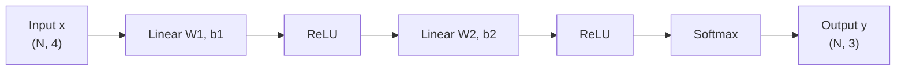

# Mini Infer


用 C++17 从零实现的最小神经网络推理引擎，支持 MLP 前向、批处理推理和 HTTP 服务。

## Features

- Tensor
- Matrix multiplication
- ReLU / Softmax / Linear
- MLP forward
- NumPy reference verification
- Catch2 tests
- Benchmark
- HTTP inference server

## Architecture



## Requirements

- CMake >= 3.15
- Ninja
- C++17 compiler
  - MSVC 2019+
  - GCC 8+
  - Clang 10+
- Python 3.10+
- NumPy

## Quick Start

Run the following commands from the project root:

```powershell
cmake -S . -B build -G Ninja -DCMAKE_BUILD_TYPE=Release
cmake --build build
ctest --test-dir build --output-on-failure
```

## Generate Data

The repository includes `data/mlp.txt` and `data/mlp_numpy_ref.txt`.
To regenerate them from scratch:

```powershell
python tools/gen_weights.py
python tools/recompute_ref.py
```

## HTTP Inference Server

### GET/health

Start the server:

```powershell
.\build\infer_server.exe
```

Start the server in one terminal. Keep it running, then use another terminal for the `curl` commands.

Check health:

```powershell
curl.exe http://127.0.0.1:8080/health
```

### POST/predict

Run a prediction:

```powershell
$body = "0.30 -1.04 0.75 0.94`n-1.95 -1.30 0.13 -0.32"
curl.exe -X POST -H "Content-Type: text/plain" --data-binary $body http://127.0.0.1:8080/predict
```

Example output:

```text
0.102567 0.0378496 0.859583
0.0061975 0.00838873 0.985414
```

## Tests

```powershell
cmake --build build
ctest --test-dir build -N
ctest --test-dir build --output-on-failure
```

## Benchmark

See [Benchmark report](docs/benchmark.md).

- i-k-j loop order: about 5x stable speedup
- inline at(): removes cross-TU function-call overhead

## Project Layout

```text
mini_infer/
├─ include/mini_infer/
├─ src/
├─ tests/
├─ benchmarks/
├─ examples/
├─ third_party/
└─ docs/
```

## Limitations

- CPU only; no CUDA or GPU support
- Only 2D Tensor
- Only a fixed two-layer MLP
- Input dimension is fixed by `W1.cols()`
- Single-threaded HTTP server
- No dynamic batching
- No JSON API
- No authentication
- No training or backpropagation
- No quantization

## Documentation

- [M1 numerical verification](docs/verify.md)
- [Benchmark report](docs/benchmark.md)
- [M4 plan](docs/m4_plan.md)

## License

[MIT](LICENSE)